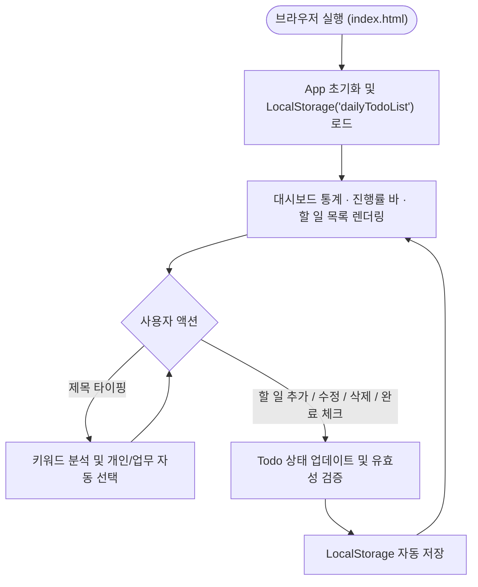

# Daily Todo — 오늘의 할 일 관리 웹 애플리케이션

**Daily Todo**는 별도의 프로그램 설치나 회원가입 없이 웹 브라우저에서 바로 사용할 수 있는 깔끔하고 직관적인 할 일 관리(To-Do) 웹 애플리케이션입니다.
입력하는 할 일 제목의 키워드를 인식해 **개인/업무 카테고리를 자동으로 분류**해 주며, 데스크톱 와이드 모니터부터 태블릿·모바일 환경까지 화면 크기에 맞춰 최적화된 레이아웃을 제공합니다.

---

## 1. 빠른 시작 (실행 방법)

별도의 서버 실행이나 패키지 설치가 필요하지 않습니다.

1. 프로젝트 폴더 안의 [`daily-todo/index.html`](./daily-todo/index.html) 파일을 찾습니다.
2. 파일을 더블 클릭하거나 사용 중인 웹 브라우저(Chrome, Edge, Safari, Firefox 등) 창으로 끌어다 놓으면 즉시 실행됩니다.

---

## 2. 주요 기능 및 사용 방법

### ① 할 일 등록 및 스마트 자동 카테고리 분류
- **할 일 입력**: 입력창에 오늘 해야 할 일을 입력하고 **추가** 버튼을 누르거나 `Enter` 키를 누릅니다.
- **키워드 기반 실시간 자동 분류**: 제목을 입력하는 동안 단어를 자동으로 분석하여 **`개인`** 또는 **`업무`** 카테고리를 실시간으로 선택해 줍니다.
  - **업무(`work`) 자동 인식 키워드 예시**: `회의`, `미팅`, `보고서`, `기획`, `결재`, `메일`, `출장`, `발표`, `개발`, `배포`, `코드`, `디자인`, `일정`, `마감`, `거래처`, `고객` 등
  - **개인(`personal`) 자동 인식 키워드 예시**: `운동`, `헬스`, `산책`, `병원`, `약국`, `장보기`, `마트`, `청소`, `빨래`, `독서`, `공부`, `영화`, `여행`, `가족`, `친구`, `은행` 등
- **수동 카테고리 고정**: 만약 사용자가 직접 `개인` 또는 `업무` 버튼을 클릭해 선택하면, 이후 제목을 수정하더라도 **사용자가 직접 선택한 카테고리가 최우선으로 유지**됩니다.

### ② 완료 체크 및 실시간 진행률 대시보드
- 각 할 일 왼쪽의 **체크박스**를 클릭하면 완료 상태가 전환되며, 완료된 항목은 취소선과 함께 시각적으로 구분됩니다.
- 할 일을 추가·완료·삭제할 때마다 대시보드의 **전체 할 일 / 완료된 할 일 / 미완료 할 일** 개수와 **전체 진행률(%) 바**가 실시간으로 계산되어 움직입니다.

### ③ 할 일 인라인 수정 및 삭제
- **수정**: 할 일 항목의 `수정` 버튼을 누르면 그 자리에서 바로 제목과 카테고리를 변경할 수 있습니다.
  - 수정 입력창에서 `Enter` 키를 누르거나 `저장` 버튼을 클릭하면 즉시 반영됩니다.
  - `Escape` 키를 누르거나 `취소` 버튼을 클릭하면 변경 사항을 취소하고 원래 상태로 돌아갑니다.
- **삭제**: `삭제` 버튼을 누르면 실수로 지우는 것을 방지하기 위한 확인 창이 표시되며, 확인 시 목록에서 즉시 삭제됩니다.

### ④ 데이터 자동 저장 (영속성)
- 모든 할 일 목록과 완료 상태는 사용 중인 브라우저의 **LocalStorage(`dailyTodoList`)**에 자동으로 저장됩니다.
- 브라우저 탭을 새로고침(`F5`)하거나 브라우저를 닫았다가 다시 열어도 이전 데이터가 그대로 유지됩니다.

---

## 3. 반응형 화면 구성 (데스크톱 / 태블릿 / 모바일)

화면 해상도에 따라 가장 보기 편한 레이아웃으로 자동 전환됩니다.

- **데스크톱 와이드 화면 (`1024px` 이상)**:
  - 모니터 전체 폭을 넓게 활용하는 **2열 SaaS 대시보드 레이아웃**으로 표시됩니다.
  - **좌측 고정 패널**: 오늘의 진행률(Progress Bar)과 전체/완료/미완료 통계 카드를 한눈에 볼 수 있도록 고정(Sticky) 배치됩니다.
  - **우측 메인 워크스페이스**: 할 일 입력 바와 등록된 할 일 목록을 넓은 가로 폭으로 쾌적하게 관리할 수 있습니다.
- **태블릿 및 모바일 화면 (`1023px` 이하)**:
  - 상단 대시보드 요약 카드와 하단 할 일 목록이 세로로 자연스럽게 배치되며, 작은 화면에서도 버튼과 입력창을 터치하기 쉽도록 자동 정렬됩니다.

---

## 4. 시스템 동작 플로우차트



---

## 5. 프로젝트 폴더 구조

```text
Lab4/
├── GEMINI.md               # 프로젝트 진행 상황, 기술 스택 및 아키텍처 문서
├── README.md               # 사용자를 위한 프로젝트 안내서 (현재 문서)
└── daily-todo/             # 웹 애플리케이션 소스 폴더
    ├── index.html          # 메인 HTML 파일 (시맨틱 마크업 및 웹 접근성 적용)
    ├── README.md           # 상세 기술 및 테스트 명세 문서
    ├── css/
    │   └── style.css       # 데스크톱 2열 와이드 & 모바일 반응형 스타일시트
    └── js/
        ├── storage.js      # LocalStorage 데이터 조회/저장 및 예외 처리 모듈
        ├── todo.js         # 할 일 CRUD, 통계 계산, 키워드 자동 분류 핵심 로직
        └── app.js          # UI 렌더링 및 사용자 이벤트 제어 컨트롤러
```
