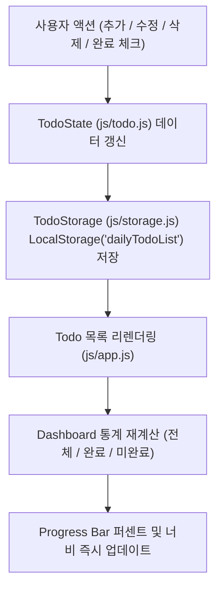

# Daily Todo — 오늘의 할 일 관리 웹 애플리케이션

Notion과 최신 SaaS 대시보드에서 영감을 받아 제작된 미니멀하고 직관적인 단일 페이지 할 일 관리(To-Do) 웹 애플리케이션입니다.
외부 프레임워크나 별도의 백엔드 서버 없이 순수 **HTML5, CSS3, Vanilla JavaScript**와 브라우저 **LocalStorage**만을 사용하여 가볍고 빠르게 동작합니다.

---

## 1. 빠른 시작 (실행 방법)

별도의 빌드 도구나 웹 서버 설치 없이 바로 사용할 수 있습니다.

1. 현재 폴더의 [`index.html`](./index.html) 파일을 웹 브라우저(Chrome, Edge, Safari, Firefox 등)에서 직접 엽니다.
2. 입력창에 오늘의 할 일을 입력하고 **`Enter` 키** 또는 **`추가` 버튼**을 눌러 할 일을 등록합니다.
3. 등록된 항목은 브라우저의 `LocalStorage`에 자동 저장되어 새로고침하거나 브라우저를 다시 실행해도 그대로 유지됩니다.

---

## 2. 주요 기능 안내

### ① 대시보드 및 실시간 진행률 (Dashboard & Progress Bar)
- **통계 요약 카드**: 전체 할 일(`totalCount`), 완료된 할 일(`completedCount`), 미완료 할 일(`remainingCount`) 개수를 실시간으로 집계하여 표시합니다.
- **진행률 계산**: $\text{진행률(\%)} = \text{round}\left(\frac{\text{completedCount}}{\text{totalCount}} \times 100\right)$ 공식을 기반으로 `0% ~ 100%`의 진행률 숫자와 부드러운 애니메이션 Progress Bar를 동시에 갱신합니다. (등록된 할 일이 0개일 때는 안전하게 `0%`로 예외 처리됩니다.)

### ② 할 일 추가 및 키워드 기반 자동 카테고리 분류 (Create & Smart Category)
- **키워드 기반 실시간 자동 카테고리 전환**: 할 일 제목을 타이핑할 때마다 제목에 포함된 키워드를 실시간 분석하여 **`개인`** 또는 **`업무`** 카테고리를 자동으로 선택합니다.
  - **업무(`work`) 주요 키워드**: `회의`, `미팅`, `보고`, `보고서`, `기획`, `기획서`, `제안서`, `발표`, `프레젠테이션`, `메일`, `이메일`, `결재`, `출장`, `야근`, `클라이언트`, `고객`, `거래처`, `프로젝트`, `업무`, `개발`, `배포`, `코드`, `리뷰`, `테스트`, `버그`, `디자인`, `시안`, `일정`, `마감`, `계약`, `견적`, `세미나`, `워크샵`, `면접`, `채용`, `예산`, `정산`, `매출`, `실적`, `자료`
  - **개인(`personal`) 주요 키워드**: `운동`, `헬스`, `요가`, `필라테스`, `러닝`, `산책`, `조깅`, `병원`, `치과`, `약국`, `진료`, `검진`, `장보기`, `마트`, `쇼핑`, `택배`, `청소`, `빨래`, `세탁`, `설거지`, `요리`, `식사`, `점심`, `저녁`, `아침`, `커피`, `카페`, `독서`, `책`, `공부`, `영어`, `학원`, `강의`, `인강`, `영화`, `드라마`, `게임`, `취미`, `여행`, `휴가`, `캠핑`, `가족`, `부모님`, `친구`, `약속`, `모임`, `생일`, `선물`, `은행`, `적금`, `공과금`, `이체`, `미용실`, `헤어`, `수면`, `휴식`, `일기`, `비타민`, `영양제`, `강아지`, `고양이`, `반려견`
- **수동 선택 우선순위 보장**: 사용자가 카테고리 버튼(`개인`/`업무`)을 직접 클릭해 선택한 경우, 이후 제목을 계속 입력하더라도 사용자의 수동 선택이 덮어써지지 않고 유지됩니다.
- **입력값 검증**: 공백만 입력된 제목은 등록을 차단하고 입력창에 포커스를 유지하며, 정상 입력 시 앞뒤 공백(`trim`)을 제거하여 등록한 뒤 입력창과 수동 선택 상태를 초기화합니다.

### ③ 인라인 할 일 수정 (Update)
- 각 항목의 `수정` 버튼을 누르면 해당 항목이 즉시 인라인 수정 모드로 전환됩니다.
- 수정 중에도 제목을 변경하면 키워드 기반 자동 카테고리 분류가 동작하며, 카테고리 배지를 직접 클릭하면 수동 선택이 우선 적용됩니다.
- `저장` 버튼 클릭 또는 수정 입력창에서 `Enter` 키 입력 시 변경 사항이 저장되고, `취소` 버튼 클릭 또는 `Escape` 키 입력 시 원래 상태로 복구됩니다.

### ④ 할 일 삭제 및 완료 토글 (Delete & Toggle)
- **완료 체크**: 체크박스를 클릭해 완료(`completed: true`) 및 미완료(`completed: false`) 상태를 즉시 전환하며, 완료된 항목은 취소선과 흐린 텍스트로 구분됩니다.
- **삭제 확인**: `삭제` 버튼 클릭 시 확인 창(`confirm`)을 거쳐 안전하게 삭제합니다.

### ⑤ 데스크톱 와이드 2열 & 모바일 반응형 디자인
- **데스크톱 (`1024px` 이상)**: 최대 폭 `1440px ~ 1600px`의 전체 화면을 활용하는 **2열 SaaS 대시보드 레이아웃**(좌측 Sticky 대시보드 패널 + 우측 입력 바 및 목록 워크스페이스)으로 동작합니다.
- **태블릿 (`768px ~ 1023px`) & 모바일 (`767px` 이하)**: 화면 폭에 맞춰 1열 레이아웃 및 터치 친화적인 버튼 배치로 자동 전환됩니다.

---

## 3. 아키텍처 및 데이터 흐름



---

## 4. 폴더 및 파일 구조

```text
daily-todo/
├── index.html          # 시맨틱 HTML5 마크업 및 웹 접근성(ARIA) 구조
├── README.md           # 애플리케이션 사용법 및 기술 문서
├── css/
│   └── style.css       # CSS 변수 디자인 시스템 및 데스크톱 2열 와이드 반응형 스타일
└── js/
    ├── storage.js      # LocalStorage('dailyTodoList') 조회/저장/초기화 및 예외 처리
    ├── todo.js         # Todo CRUD, 대시보드 통계, 키워드 기반 카테고리 자동 분류 로직
    └── app.js          # DOM 렌더링, 이벤트 위임 및 UI 동기화 컨트롤러
```
